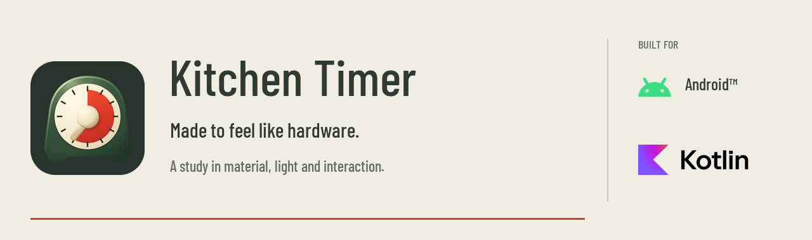
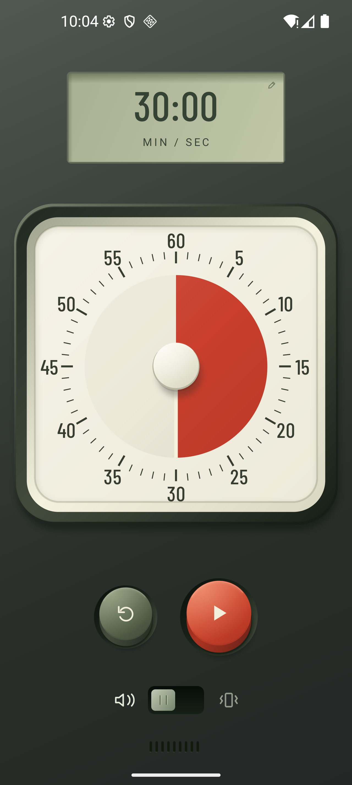
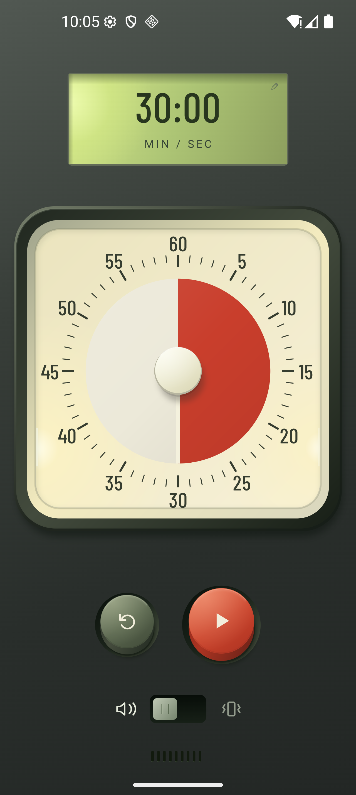
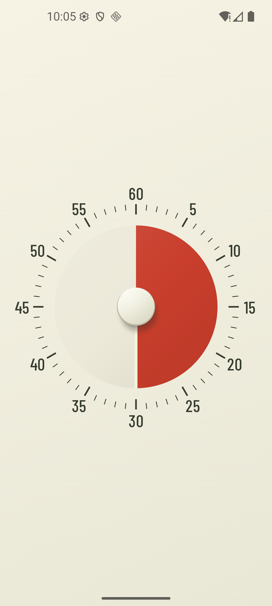
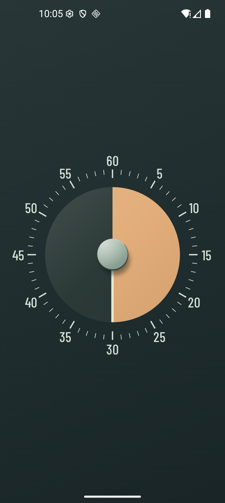
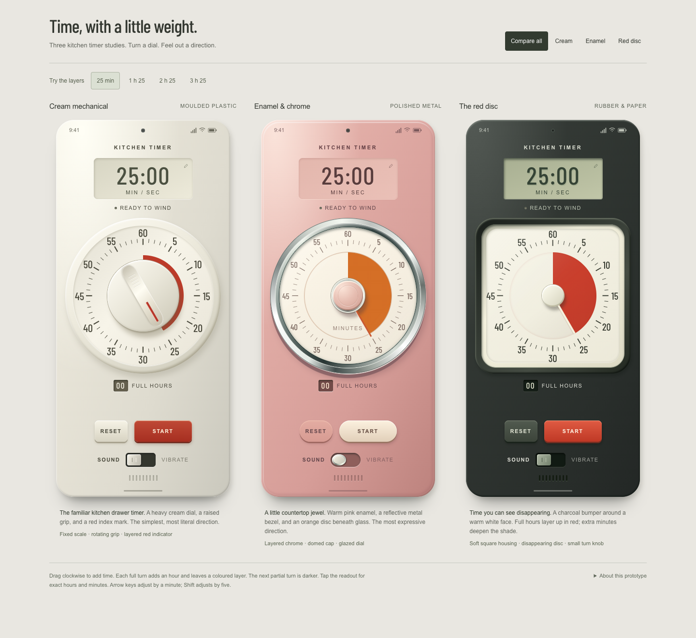

<div align="center">
  

[](app/build.gradle.kts)
[](build.gradle.kts)
[](LICENSE)

**A kitchen timer that feels like a small physical object.**
</div>

Wind the dial, watch the red disc disappear, press a raised button. Kitchen Timer is an offline Android app built around the visual and tactile character of hardware timers: recessed surfaces, printed scales, localized light and deliberate feedback.

This repository includes the native app, the working HTML studies and the decisions that connected them. It was designed by Goutham Ganesan in collaboration with Codex, with human direction and repeated visual critique guiding the implementation.

<p align="center">
  
  
  
  
</p>

## Download for Android

[**Download Kitchen Timer 0.1.2 APK**](https://github.com/gouthamganesan/kitchen-timer-android/releases/download/v0.1.2/Kitchen-Timer-0.1.2-debug.apk) · [Release notes and checksum](https://github.com/gouthamganesan/kitchen-timer-android/releases/tag/v0.1.2)

Android 8.0 or later. This is a development preview, signed with a debug key, and installed directly from the APK. Android may ask you to allow installation from your browser. It is the same build tested locally and installed on the author's phone.

Successful [Actions runs](https://github.com/gouthamganesan/kitchen-timer-android/actions/workflows/android.yml) also retain their debug APK for 30 days. Those runner-generated APKs use temporary debug keys and may require uninstalling a differently signed copy, which removes its saved settings. Use the release download above for this preview.

## The process: finding the taste

The starting brief was specific: make an Android timer feel like an actual kitchen timer, with visual appeal at the centre. Taste became a sequence of decisions about material, hierarchy and behavior. Each revision had to make the object more convincing or make it easier to use.

### 1. Explore the object before building the app

We began with photographs of physical timers and a rough sketch of the interaction: a dial, an exact-time readout and a sound switch. Three buildable HTML studies explored different material languages.



| Direction | What it explored |
| --- | --- |
| Cream mechanical | Moulded plastic, a large grip and familiar kitchen-drawer proportions. |
| Enamel & chrome | Pink enamel, a metal bezel and an orange sector under glass. |
| The red disc | Charcoal housing, a recessed ivory face and time expressed as a disappearing area. |

The red disc was selected. It gave the interface a clear visual centre and a way to read remaining time at a glance. The [original studies](reference/studies-v1.html) and [refined prototype](reference/approved-prototype.html) remain runnable offline: download or clone the repo and open either file in a browser.

### 2. Refine through specific criticism

The useful feedback was concrete: remove this label, make that button feel pressable, keep the lighting local. The visual direction emerged through these corrections.

| Iteration | Design judgment |
| --- | --- |
| Remove the title, status line and separate hour counter | Let the dial carry the screen. The LCD already gives the exact duration. |
| Replace flat controls with round icon plungers | Sockets, sidewalls, travel and press lighting give a button a believable physical action. |
| Darken the disc with each full revolution | Extend the winding metaphor to hours while keeping the exact value in the LCD. |
| Light the displays in dark mode | Keep the casing's material. Concentrate yellow-green light near the LCD emitter and diffuse warm light around the dial. |
| Strip focus mode back to the dial | Preserve the earlier minimal design. Remove quick presets so the centre has one immediate start/pause action. |
| Remove the bottom dash, then rebalance the gaps | Removing an element changes the whole composition. Spread the controls deliberately instead of leaving an empty pocket. |
| Remove the sound switch's rectangular ripple | Feedback belongs to the physical switch and its snap, without an unrelated dark patch behind the icons. |

These choices are the project's idea of good UI/UX: **the appearance tells you how something behaves, and the behavior reinforces what you see.**

### 3. Make the physical idea work on a phone

Winding crosses minute detents, firmer five-minute marks and an hour clunk. End stops fire once at a boundary. Those effects happen only while setting time; a running countdown does not generate mechanical ticks.

Exact entry uses a custom duration picker with clock and keyboard input. Double-tapping the knob opens fixed presets in regular mode. Swiping up opens settings for Stay awake, Focus mode and the general Light / Dark / Follow system preference.

The native implementation also exposed details a static mockup could hide. Changing to an hours readout initially moved the dial during winding; a stable LCD height fixed it. Small screens needed explicit space for picker actions and the sound switch. These are part of the visual design, because an object stops feeling solid when its geometry shifts under your finger.

### 4. Carry the design into native Android

The app uses Kotlin, Jetpack Compose and Canvas. The timer face, shadows, disc and controls are drawn in code. Android handles background alarms, notification actions and system haptics; the HTML remains a design reference.

Codex agents worked on UI, platform behavior and haptics/testing with shared contracts and maintained handoffs. Human review set the direction, rejected unnecessary elements and kept the material treatment consistent. The [requirements](docs/REQUIREMENTS.md), [architecture](docs/ARCHITECTURE.md) and [agent records](docs/agents) preserve that work.

The icon followed the same path: an [image-generated concept](artwork/kitchen-timer-icon/kitchen-timer-icon.origin.png), then a [true editable SVG](artwork/kitchen-timer-icon/kitchen-timer-icon.svg), then Android adaptive and themed icons. It keeps the timer's housing, ivory dial, red sector and winding paddle at launcher size.

## Build and run

Requires JDK 17+, Android SDK Platform 36 and Android SDK Build Tools 35.0.0. Open the root folder in Android Studio, or set `ANDROID_HOME` to your SDK and `JAVA_HOME` to your JDK.

```sh
./scripts/check.sh
adb -s DEVICE_SERIAL install -r app/build/outputs/apk/debug/app-debug.apk
```

On Windows, run `gradlew.bat assembleDebug testDebugUnitTest lintDebug`. No accounts, API keys or server are needed. Grant exact-alarm access and notification permission through the app when prompted.

The build workflow runs compilation, unit tests and lint. The [test record](docs/testing/TEST-MATRIX.md) separates automated results, emulator observations and physical-device checks. See [Maestro instructions](maestro/README.md) for interaction tests and [CONTRIBUTING](CONTRIBUTING.md) for design changes.

<details>
<summary>Behavior and limits</summary>

- One timer, from zero to 23 hours 59 minutes. More turns add darker layers; the LCD is authoritative for exact duration.
- Countdown uses a monotonic deadline. AlarmManager schedules background completion; a foreground service runs only while the alarm is ringing.
- The notification has a native live countdown and Pause/Resume/Reset actions. Its timer illustration is a snapshot, and Android controls the surrounding layout and dismissal.
- Force-stopping the app cancels Android alarms until reopening. Permission and channel controls affect delivery; the app does not bypass them.
- Stay awake applies only while the activity is visible. Settings and timer state stay on the device. The app has no Internet permission or analytics.
- Physical haptic strength, audio, DND and locked/Doze behavior need device-specific testing. Installing an APK is not proof of those results.

</details>

## License and credits

[MIT](LICENSE), © 2026 Goutham Ganesan. Barlow Condensed, the Gradle wrapper and platform logos retain their own terms; see [third-party notices](THIRD_PARTY_NOTICES.md).

Android is a trademark of Google LLC. The Android robot is reproduced or modified from work created and shared by Google and used according to the [Creative Commons 3.0 Attribution License](https://creativecommons.org/licenses/by/3.0/). Kotlin is a trademark of the Kotlin Foundation. This is an independent project, unaffiliated with those organizations.
